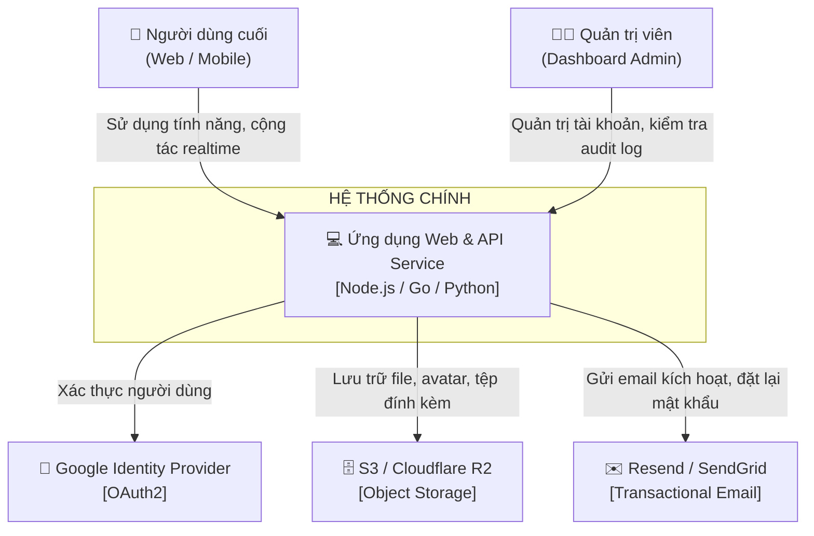
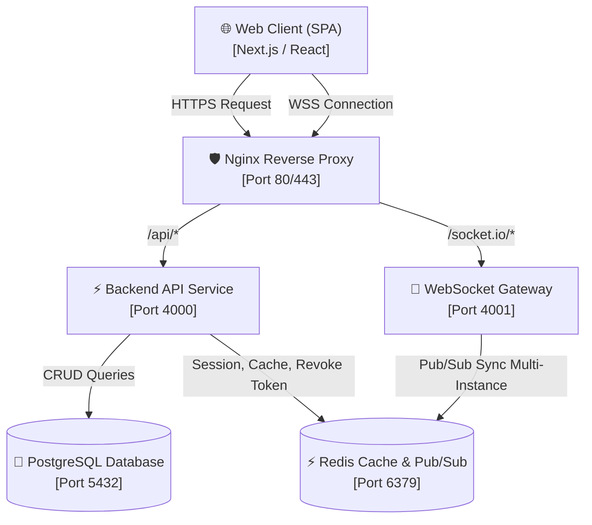
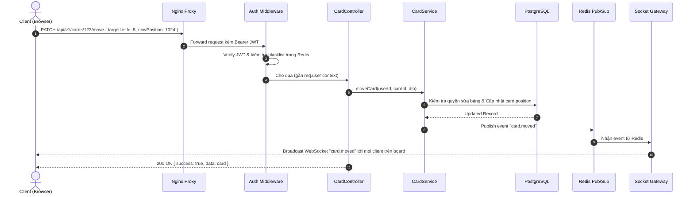
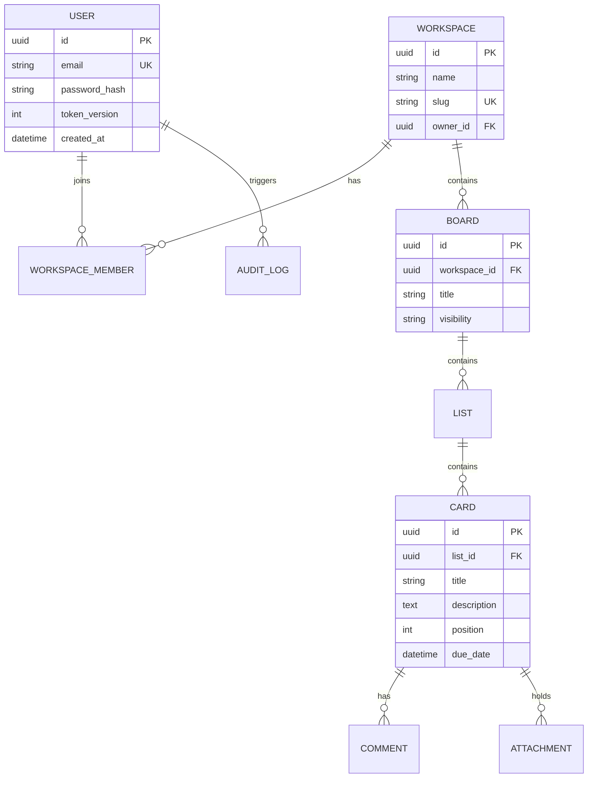

# /architecture-plan - Quét & Tạo Hồ Sơ Kiến Trúc Hệ Thống (System Architecture C4)

> **Trigger**: `/architecture-plan <"audit" | "init" | "update" | empty>`
> **Mục tiêu**: Tự động rà soát toàn bộ repository, phát hiện stack kỹ thuật, phân tích luồng dữ liệu, và sinh ra file tài liệu kiến trúc kỹ thuật toàn diện `docs/02-ky-thuat/architecture.md` chuẩn 16 mục C4 Model.
> **Nguyên tắc vàng**:
> 1. **Cites `path:line`**: Mọi phát biểu về kiến trúc, thành phần, cấu hình, bảo mật phải dẫn chứng chính xác đường dẫn tương đối từ thư mục gốc (`path:line`). Nếu chưa có code thật, bắt buộc ghi chú `(Inferred: ...)` hoặc `[Dự kiến]`. Tuyệt đối không bịa đặt code.
> 2. **Bảo toàn vệ sinh thư mục gốc (Root Hygiene)**: Kiểm tra và đảm bảo thư mục gốc chỉ chứa duy nhất 2 file hiến pháp: `AGENTS.md` và `CLAUDE.md`. Mọi tài liệu kiến trúc phải nằm đúng trong `docs/02-ky-thuat/`.
> 3. **Phân định rõ ranh giới trách nhiệm (Domain Responsibility)**: Độc lập giữa `frontend/`, `backend/`, `infra/`, `mcp/`, `ai/`.

---

## 1. Các chế độ hoạt động (Modes)

| Đầu vào | Chế độ | Hành động thực hiện |
|---|---|---|
| `init` hoặc để trống | **Khởi tạo kiến trúc (Init)** | Quét toàn bộ repository, bóc tách tech stack, container, DB schema, API routes, và tạo mới file `docs/02-ky-thuat/architecture.md` theo 16 mục chuẩn C4. |
| `audit` | **Thẩm định & Kiểm tra lệch (Audit)** | Đối chiếu file `architecture.md` hiện có với code thực tế. Phát hiện các file bị lệch, các endpoint mới chưa cập nhật, cảnh báo các file rác vi phạm Root Hygiene. |
| `update` | **Cập nhật kiến trúc (Update)** | Giữ nguyên các phần kiến trúc tĩnh, chỉ cập nhật các module, database entities, routes hoặc event realtime mới được thêm vào codebase. |

---

## 2. Quy trình quét & thực hiện (5 bước)

### Bước 1 - Quét sâu hệ thống (Deep Workspace Scan)
AI tự động đọc codebase theo thứ tự chi phí thấp đến cao:
1. **Root & Configs**: `package.json`, `pnpm-workspace.yaml`, `go.mod`, `Cargo.toml`, `requirements.txt`, `docker-compose.yml`, `Dockerfile`.
2. **Cơ sở dữ liệu & Mô hình dữ liệu**: `prisma/schema.prisma`, `migrations/`, ORM models (TypeORM, Drizzle, SQLAlchemy, Django models, GORM).
3. **Định tuyến & Middleware**: Routes backend, controller, authentication middleware, RBAC guards, CORS, rate limiting.
4. **Realtime & Event Bus**: Socket.IO handlers, WebSocket listeners, SSE routes, Redis Pub/Sub channels, RabbitMQ/Kafka topics.
5. **Frontend Architecture**: Cấu trúc pages/app router, state store (Zustand, Redux, TanStack Query), API client, component layers.

### Bước 2 - Kiểm tra tiêu chuẩn Vibe Coding & Thư mục Docs
1. **Kiểm tra thư mục gốc**:
   - Nếu phát hiện file `.md` lạ ở root (ngoài `AGENTS.md` và `CLAUDE.md`), liệt kê và cảnh báo tự động chuyển về đúng nhóm trong `docs/`.
2. **Kiểm tra cấu trúc 7 nhóm trong `docs/`**:
   - `01-tong-quan/` (Overview & Scope)
   - `02-ky-thuat/` (Technical: Architecture, Business Flows, DB Schema)
   - `03-san-pham/` (Product: Roadmap, PRD, Changelog)
   - `04-van-hanh/` (Operations: Deploy, Runbook, CI/CD, Backup)
   - `05-mau/` (Templates, Forms, Checklists)
   - `06-design/` (UI/UX, Wireframe, Design Tokens)
   - `99-ghi-chu/` (Notes nháp chưa phân loại)

### Bước 3 - Soạn thảo hồ sơ kiến trúc 16 mục C4
Ghi nội dung vào `docs/02-ky-thuat/architecture.md` tuân thủ đầy đủ 16 mục theo Template chuẩn bên dưới. Sử dụng biểu đồ Mermaid:
- C4 Context: `flowchart TB`
- C4 Container: `flowchart TB` với boundary nhóm container
- Data Model: `erDiagram`
- State Machine / Request Flow: `sequenceDiagram`

### Bước 4 - Kiểm chứng trích dẫn (Verification)
- Kiểm tra từng đường dẫn file được trích dẫn trong văn bản có tồn tại thật trong repo hay không.
- Nếu file chưa được code, bắt buộc ghi rõ: `(Inferred: Dự kiến triển khai tại <path>)`.

### Bước 5 - Báo cáo hoàn tất (Tối đa 6 dòng)
- Đường dẫn file: `[architecture.md](file:///docs/02-ky-thuat/architecture.md)`
- Tóm tắt kiến trúc: Tech stack chính, số lượng container, số lượng endpoint, số lượng bảng DB.
- Trạng thái Root Hygiene: `SẠCH (Chỉ có AGENTS.md & CLAUDE.md)` hoặc cảnh báo các file rác cần dọn.

---

## 3. Template chuẩn: `docs/02-ky-thuat/architecture.md`

````markdown
# [Tên Dự Án] - Hồ Sơ Kiến Trúc Hệ Thống (System Architecture)

> **Tài liệu kiến trúc chính thức**, được tạo và bảo trì tự động bởi lệnh `/architecture-plan`.  
> Bao gồm toàn bộ các phân hệ: `frontend`, `backend`, `infra`, `mcp`, `ai` và tài liệu chuẩn `docs/`.  
> Mọi khẳng định kỹ thuật đều dẫn chứng `path:line` thực tế từ thư mục gốc; các thành phần dự kiến được đánh dấu `(Inferred: ...)`.

---

## Mục lục (Table of Contents)

0. [Thông tin tài liệu (Document Metadata)](#0-thông-tin-tài-liệu-document-metadata)
1. [Tổng quan dự án (Project Overview)](#1-tổng-quan-dự-án-project-overview)
2. [Bối cảnh hệ thống - C4 Level 1 (System Context)](#2-bối-cảnh-hệ-thống---c4-level-1-system-context)
3. [Công nghệ sử dụng (Tech Stack)](#3-công-nghệ-sử-dụng-tech-stack)
4. [Cấu trúc thư mục & Ranh giới trách nhiệm (Folder Structure)](#4-cấu-trúc-thư-mục--ranh-giới-trách-nhiệm-folder-structure)
5. [Kiến trúc Container - C4 Level 2 (Container Architecture)](#5-kiến-trúc-container---c4-level-2-container-architecture)
6. [Phân rã thành phần & Module (Component Architecture)](#6-phân-rã-thành-phần--module-component-architecture)
7. [Luồng xử lý yêu cầu (Request Flow)](#7-luồng-xử-lý-yêu-cầu-request-flow)
8. [Cơ chế xác thực (Authentication)](#8-cơ-chế-xác-thực-authentication)
9. [Cơ chế phân quyền (Authorization & RBAC)](#9-cơ-chế-phân-quyền-authorization--rbac)
10. [Kiến trúc dữ liệu (Data Architecture & ERD)](#10-kiến-trúc-dữ-liệu-data-architecture--erd)
11. [Quy chuẩn API (API Architecture)](#11-quy-chuẩn-api-api-architecture)
12. [Danh mục sự kiện Realtime & Bất đồng bộ (Realtime & Async Catalog)](#12-danh-mục-sự-kiện-realtime--bất-đồng-bộ-realtime--async-catalog)
13. [Ánh xạ luồng nghiệp vụ (Business Flows Mapping)](#13-ánh-xạ-luồng-nghiệp-vụ-business-flows-mapping)
14. [Kiến trúc Giao diện Frontend (Frontend Architecture)](#14-kiến-trúc-giao-diện-frontend-frontend-architecture)
15. [Đồ thị phụ thuộc (Dependency Graph)](#15-đồ-thị-phụ-thuộc-dependency-graph)
16. [Dịch vụ & Tích hợp bên ngoài (External Services & Integrations)](#16-dịch-vụ--tích-hợp-bên-ngoài-external-services--integrations)

---

## 0. Thông tin tài liệu (Document Metadata)

| Thuộc tính | Giá trị |
|---|---|
| **Dự án** | [Tên Dự Án] |
| **Phiên bản kiến trúc** | v1.0.0 |
| **Lần cập nhật cuối** | YYYY-MM-DD |
| **Lệnh duy trì** | `/architecture-plan` |
| **Phân hệ bao phủ** | `frontend/`, `backend/`, `infra/`, `mcp/`, `ai/` |
| **Trạng thái Root Hygiene** | `[OK] ĐẠT CHUẨN (Chỉ có AGENTS.md & CLAUDE.md tại root)` |

---

## 1. Tổng quan dự án (Project Overview)
- **Mục tiêu hệ thống**: [Mô tả bài toán cốt lõi hệ thống giải quyết].
- **Đối tượng phục vụ**: [Khách vãng lai, Thành viên, Quản trị viên Workspace, Super Admin].
- **Ràng buộc phi chức năng**: Độ trễ API < 200ms, hỗ trợ Realtime sync tức thời, bảo mật dữ liệu nhiều tầng.

---

## 2. Bối cảnh hệ thống - C4 Level 1 (System Context)



---

## 3. Công nghệ sử dụng (Tech Stack)

| Tầng hệ thống | Công nghệ lựa chọn | Phiên bản | Đường dẫn cấu hình chứng minh |
|---|---|---|---|
| **Frontend** | React / Next.js / TypeScript | Latest | `frontend/package.json` |
| **Styling & UI** | Tailwind CSS / shadcn/ui | Latest | `frontend/tailwind.config.js` |
| **Backend API** | Node.js (NestJS/Express) hoặc Go / FastAPI | Latest | `backend/package.json` |
| **Database** | PostgreSQL | 16+ | `infra/docker-compose.yml` |
| **ORM / Migrations** | Prisma / Drizzle | Latest | `backend/prisma/schema.prisma` |
| **Cache & Realtime** | Redis & Socket.IO | 7.x | `backend/src/realtime/` |
| **Hạ tầng & Container** | Docker, Nginx Reverse Proxy | Latest | `infra/Dockerfile` |

---

## 4. Cấu trúc thư mục & Ranh giới trách nhiệm (Folder Structure)

```text
├── AGENTS.md              # [BẮT BUỘC] Hiến pháp chung cho mọi AI Agent
├── CLAUDE.md              # [BẮT BUỘC] Quy tắc vận hành riêng cho Claude Code
├── docs/                  # [DUY NHẤT] Trung tâm lưu trữ toàn bộ tài liệu dự án
│   ├── README.md          # Index mục lục toàn bộ tài liệu kèm 1 dòng tóm tắt
│   ├── 01-tong-quan/      # Mục tiêu, phạm vi dự án
│   ├── 02-ky-thuat/       # architecture.md, business-flows.md, tech specs
│   ├── 03-san-pham/       # roadmap.md, changelog.md, PRD
│   ├── 04-van-hanh/       # Hướng dẫn deploy, CI/CD, docker runbook
│   ├── 05-mau/            # Biểu mẫu yêu cầu, checklist nghiệm thu
│   ├── 06-design/         # Wireframe, Design Tokens, UX flow
│   └── 99-ghi-chu/        # Ghi chép nháp
├── frontend/              # [Domain Boundary] Chỉ code Client UI/UX (có mini AGENTS.md)
├── backend/               # [Domain Boundary] Chỉ code REST/GraphQL API & Services (có mini AGENTS.md)
├── infra/                 # [Domain Boundary] Docker, Nginx, CI/CD, Database (có mini AGENTS.md)
├── mcp/                   # [Domain Boundary] Model Context Protocol servers
├── ai/                    # [Domain Boundary] AI Prompt, Vector DB, RAG pipeline
└── scripts/               # Scripts tiện ích quản trị & Git worktree
```

---

## 5. Kiến trúc Container - C4 Level 2 (Container Architecture)



---

## 6. Phân rã thành phần & Module (Component Architecture)

- **AuthModule** (`backend/src/modules/auth`): Quản lý đăng ký, đăng nhập, JWT, refresh token rotation, OAuth2 Google.
- **WorkspaceModule** (`backend/src/modules/workspace`): Quản lý workspace, quyền sở hữu, mời thành viên qua email.
- **BoardModule** (`backend/src/modules/board`): CRUD bảng công việc, phân quyền bảng (Public/Private/Workspace).
- **CardModule** (`backend/src/modules/card`): Quản lý vòng đời thẻ, kéo thả sắp xếp (lexorank/position), nhãn màu, hạn chót.
- **CommentModule** (`backend/src/modules/comment`): Bình luận thẻ, parse cú pháp `@mention` thông báo thành viên.
- **NotificationModule** (`backend/src/modules/notification`): Lưu thông báo in-app và đẩy sự kiện realtime tới client.

---

## 7. Luồng xử lý yêu cầu (Request Flow)



---

## 8. Cơ chế xác thực (Authentication)
- **Access Token**: JSON Web Token (JWT), thời hạn sống ngắn: **15 phút**, mang `userId`, `email`, `roleVersion`. Ký bằng `JWT_SECRET` (HMAC SHA-256).
- **Refresh Token**: Chuỗi ngẫu nhiên mã hóa an toàn (cryptographically secure string), lưu trong Cookie `HttpOnly; Secure; SameSite=Strict`. Thời hạn **7 ngày**.
- **Chống đánh cắp Refresh Token (Reuse Detection)**:
  - Mỗi khi refresh, token cũ bị đánh dấu đã dùng (`used = true`).
  - Nếu token đã dùng bị gửi lại một lần nữa -> Hệ thống phát hiện nghi vấn tấn công -> **Thu hồi ngay lập tức toàn bộ phiên đăng nhập** của người dùng đó, ghi log audit `auth.refresh.reuse_detected`.
- **Đăng xuất tức thì (Revocation List)**:
  - Khi đăng xuất, mã định danh token (`jti`) được đưa vào Redis Blacklist với TTL bằng đúng thời gian còn lại của Access Token.

---

## 9. Cơ chế phân quyền (Authorization & RBAC)
- **Quy tắc bất di bất dịch**: **Server quyết định 100% quyền hạn**. Ẩn nút trên UI chỉ là tối ưu trải nghiệm (UX), không phải bảo mật.
- **Hệ thống phân cấp vai trò**:
  1. `super_admin`: Toàn quyền hệ thống, tra cứu audit log toàn cục.
  2. `workspace_owner`: Chủ workspace, quản lý thanh toán, xóa workspace.
  3. `workspace_admin`: Quản lý thêm/bớt thành viên, tạo board.
  4. `workspace_member`: Tạo board cá nhân, tham gia các board được chia sẻ.
  5. `guest`: Khách chỉ đọc hoặc chỉ thao tác trên một số card được chỉ định.

---

## 10. Kiến trúc dữ liệu (Data Architecture & ERD)



---

## 11. Quy chuẩn API (API Architecture)
- **Base URL**: `/api/v1`
- **Quy ước định dạng JSON**: Toàn bộ Request / Response body dùng `camelCase`.
- **Cấu trúc phản hồi chuẩn**:
  ```json
  {
    "success": true,
    "data": { ... },
    "error": null,
    "timestamp": "2026-11-02T12:00:00.000Z"
  }
  ```
- **Quy chuẩn mã lỗi (RFC 7807)**:
  ```json
  {
    "success": false,
    "data": null,
    "error": {
      "code": "CARD_NOT_FOUND",
      "message": "Không tìm thấy thẻ có mã tương ứng hoặc bạn không có quyền truy cập.",
      "details": []
    }
  }
  ```

---

## 12. Danh mục sự kiện Realtime & Bất đồng bộ (Realtime & Async Catalog)

| Kênh (Channel) | Tên sự kiện (Event) | Nguồn phát | Đối tượng nhận | Mục đích |
|---|---|---|---|---|
| `board:<id>` | `card.created` | Backend API | Mọi client trên board | Thêm thẻ mới realtime |
| `board:<id>` | `card.moved` | Backend API | Mọi client trên board | Cập nhật vị trí kéo thả |
| `board:<id>` | `comment.added` | Backend API | Mọi client trên board | Hiển thị bình luận mới |
| `user:<id>` | `notification.received` | Notification Service | Client của user đích | Bật popup / toast thông báo |
| `queue:email` | `send_welcome_email` | Auth Service | Email Background Worker | Gửi email chào mừng async |

---

## 13. Ánh xạ luồng nghiệp vụ (Business Flows Mapping)

| Mã quy trình | Tên quy trình trong `business-flows.md` | Controller phụ trách | Trạng thái triển khai |
|---|---|---|:---:|
| `QT-01` | Đăng ký, đăng nhập, cài đặt lần đầu | `AuthController` | ✅ ĐÃ XONG |
| `QT-02` | Phiên đăng nhập (renew, logout) | `AuthController` | ✅ ĐÃ XONG |
| `QT-03` | Quên, đặt lại, đổi mật khẩu | `AuthController` | 🟡 MỘT PHẦN |
| `QT-04` | Không gian làm việc và thành viên | `WorkspaceController` | 🟡 MỘT PHẦN |
| `QT-05` | Quản lý bảng (Board) & Danh sách (List) | `BoardController` | ✅ ĐÃ XONG |
| `QT-06` | Vòng đời thẻ công việc (Card Core) | `CardController` | ✅ ĐÃ XONG |
| `QT-07` | Bình luận và @nhắc tên thành viên | `CommentController` | ✅ ĐÃ XONG |

---

## 14. Kiến trúc Giao diện Frontend (Frontend Architecture)
- **Mô hình kiến trúc**: Feature-based folder structure (`frontend/src/features/boards`, `frontend/src/features/cards`).
- **Quản lý trạng thái (State Management)**:
  - Server state & Caching: **TanStack Query** (tự động invalidate cache khi nhận WebSocket event).
  - Client state: **Zustand** (lưu trạng thái Sidebar, modal popups, bộ lọc tạm thời).
- **Chiến lược Optimistic Updates**: Khi kéo thả thẻ, giao diện lập tức di chuyển thẻ trên màn hình ngay lập tức; nếu server trả về lỗi, thẻ tự động nhảy về vị trí cũ và hiển thị thông báo lỗi.

---

## 15. Đồ thị phụ thuộc (Dependency Graph)
- `frontend` phụ thuộc `backend` (qua OpenAPI Contract/Types).
- `backend` phụ thuộc `infra` (PostgreSQL, Redis container).
- `ai` kết nối độc lập qua API REST/gRPC của `backend`.
- Không tồn tại quan hệ phụ thuộc vòng (circular dependency) giữa các module.

---

## 16. Dịch vụ & Tích hợp bên ngoài (External Services & Integrations)
- **Google OAuth2**: Xác thực tài khoản nhanh.
- **AWS S3 / Cloudflare R2**: Lưu trữ file ảnh đính kèm trên Card.
- **Resend / SendGrid**: Hạ tầng gửi email giao dịch.
- **Web Push Service**: Gửi thông báo trình duyệt cho người dùng offline.
````

---

## 4. Checklist kiểm tra thẩm định kiến trúc (Architecture Audit Checklist)

- [ ] Đường dẫn file luôn lưu tại: `docs/02-ky-thuat/architecture.md`.
- [ ] Thư mục gốc chỉ có đúng 2 file: `AGENTS.md` và `CLAUDE.md`.
- [ ] Đầy đủ 16 mục cấu trúc từ `0. Document Metadata` đến `16. External Services`.
- [ ] Mọi đường dẫn code được trích dẫn (`path:line`) phải được xác minh tồn tại thật trong repo.
- [ ] Các thành phần chưa triển khai bắt buộc gắn nhãn rõ ràng: `(Inferred: ...)`.
- [ ] Sơ đồ C4 Context, Container, Sequence Diagram và ERD vẽ bằng cú pháp Mermaid chuẩn, không lỗi render.
