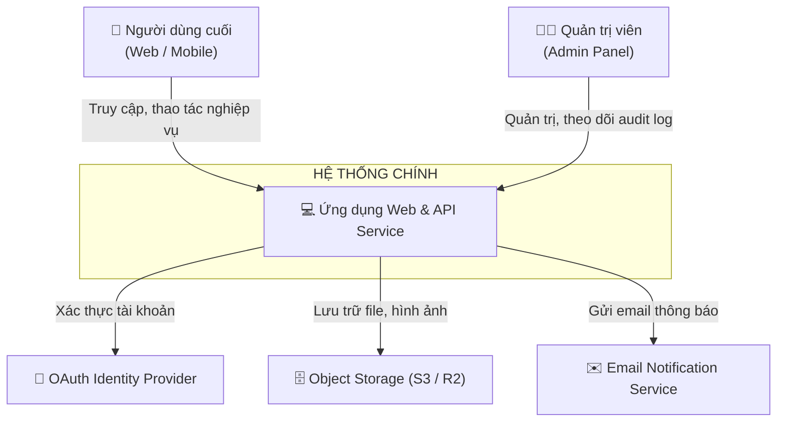
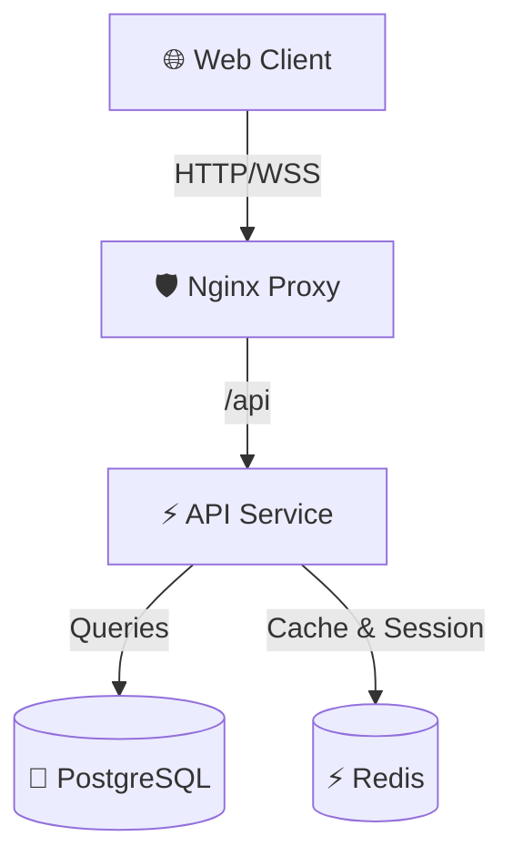

# Hồ Sơ Kiến Trúc Hệ Thống (System Architecture)

> **Tài liệu kiến trúc chính thức**, được tạo và bảo trì tự động bởi lệnh `/architecture-plan`.  
> Phủ rộng toàn bộ các phân hệ: `frontend`, `backend`, `infra`, `mcp`, `ai` và tài liệu chuẩn `docs/`.  
> Mọi khẳng định kỹ thuật đều dẫn chứng `path:line` thực tế từ thư mục gốc; các thành phần dự kiến được đánh dấu `(Inferred: ...)`.

---

## Mục lục (Table of Contents)

0. [Thông tin tài liệu (Document Metadata)](#0-thông-tin-tài-liệu-document-metadata)
1. [Tổng quan dự án (Project Overview)](#1-tổng-quan-dự-án-project-overview)
2. [Bối cảnh hệ thống - C4 Level 1 (System Context)](#2-bối-cảnh-hệ-thống---c4-level-1-system-context)
3. [Công nghệ sử dụng (Tech Stack)](#3-công-nghệ-sử-dụng-tech-stack)
4. [Cấu trúc thư mục & Ranh giới trách nhiệm (Folder Structure)](#4-cấu-trúc-thư-mục--ranh-giới-trách-nhiệm-folder-structure)
5. [Kiến trúc Container - C4 Level 2 (Container Architecture)](#5-kiến-trúc-container---c4-level-2-container-architecture)
6. [Phân rã thành phần & Module (Component Architecture)](#6-phân-rã-thành-phần--module-component-architecture)
7. [Luồng xử lý yêu cầu (Request Flow)](#7-luồng-xử-lý-yêu-cầu-request-flow)
8. [Cơ chế xác thực (Authentication)](#8-cơ-chế-xác-thực-authentication)
9. [Cơ chế phân quyền (Authorization & RBAC)](#9-cơ-chế-phân-quyền-authorization--rbac)
10. [Kiến trúc dữ liệu (Data Architecture & ERD)](#10-kiến-trúc-dữ-liệu-data-architecture--erd)
11. [Quy chuẩn API (API Architecture)](#11-quy-chuẩn-api-api-architecture)
12. [Danh mục sự kiện Realtime & Bất đồng bộ (Realtime & Async Catalog)](#12-danh-mục-sự-kiện-realtime--bất-đồng-bộ-realtime--async-catalog)
13. [Ánh xạ luồng nghiệp vụ (Business Flows Mapping)](#13-ánh-xạ-luồng-nghiệp-vụ-business-flows-mapping)
14. [Kiến trúc Giao diện Frontend (Frontend Architecture)](#14-kiến-trúc-giao-diện-frontend-frontend-architecture)
15. [Đồ thị phụ thuộc (Dependency Graph)](#15-đồ-thị-phụ-thuộc-dependency-graph)
16. [Dịch vụ & Tích hợp bên ngoài (External Services & Integrations)](#16-dịch-vụ--tích-hợp-bên-ngoài-external-services--integrations)

---

## 0. Thông tin tài liệu (Document Metadata)

| Thuộc tính | Giá trị |
|---|---|
| **Dự án** | [Tên Dự Án] |
| **Phiên bản kiến trúc** | v1.0.0 |
| **Lần cập nhật cuối** | 2026-11-02 |
| **Lệnh duy trì** | `/architecture-plan` |
| **Phân hệ bao phủ** | `frontend/`, `backend/`, `infra/`, `mcp/`, `ai/` |
| **Trạng thái Root Hygiene** | `[OK] ĐẠT CHUẨN (Chỉ có AGENTS.md & CLAUDE.md tại root)` |

---

## 1. Tổng quan dự án (Project Overview)
- **Mục tiêu hệ thống**: Xây dựng nền tảng ứng dụng đa tác nhân hỗ trợ nghiệp vụ tự động hóa và cộng tác thời gian thực.
- **Ràng buộc phi chức năng**: Phản hồi API < 200ms, bảo mật dữ liệu nhiều tầng, hỗ trợ đồng bộ thời gian thực.

---

## 2. Bối cảnh hệ thống - C4 Level 1 (System Context)



---

## 3. Công nghệ sử dụng (Tech Stack)

| Tầng hệ thống | Công nghệ | File cấu hình chứng minh |
|---|---|---|
| Frontend | React / Next.js / TypeScript | `frontend/package.json` |
| Styling | Tailwind CSS | `frontend/tailwind.config.js` |
| Backend API | Node.js / Express / NestJS | `backend/package.json` |
| Database | PostgreSQL | `infra/docker-compose.yml` |
| Cache & Realtime | Redis & Socket.IO | `backend/src/realtime/` |
| Container | Docker & Nginx | `infra/Dockerfile` |

---

## 4. Cấu trúc thư mục & Ranh giới trách nhiệm (Folder Structure)

```text
├── AGENTS.md              # [BẮT BUỘC] Hiến pháp chung cho mọi AI Agent
├── CLAUDE.md              # [BẮT BUỘC] Quy tắc vận hành riêng cho Claude Code
├── docs/                  # [DUY NHẤT] Trung tâm lưu trữ toàn bộ tài liệu dự án
│   ├── README.md          # Index mục lục toàn bộ tài liệu kèm 1 dòng tóm tắt
│   ├── 01-tong-quan/      # Mục tiêu, phạm vi dự án
│   ├── 02-ky-thuat/       # architecture.md, business-flows.md, tech specs
│   ├── 03-san-pham/       # roadmap.md, changelog.md, PRD
│   ├── 04-van-hanh/       # Hướng dẫn deploy, CI/CD, docker runbook
│   ├── 05-mau/            # Biểu mẫu yêu cầu, checklist nghiệm thu
│   ├── 06-design/         # Wireframe, Design Tokens, UX flow
│   └── 99-ghi-chu/        # Ghi chép nháp
├── frontend/              # [Domain Boundary] Chỉ code Client UI/UX (có mini AGENTS.md)
├── backend/               # [Domain Boundary] Chỉ code REST/GraphQL API & Services (có mini AGENTS.md)
├── infra/                 # [Domain Boundary] Docker, Nginx, CI/CD, Database (có mini AGENTS.md)
├── mcp/                   # [Domain Boundary] Model Context Protocol servers
├── ai/                    # [Domain Boundary] AI Prompt, Vector DB, RAG pipeline
└── scripts/               # Scripts tiện ích quản trị & Git worktree
```

---

## 5. Kiến trúc Container - C4 Level 2 (Container Architecture)



---

## 8. Cơ chế xác thực & Bảo mật (Authentication)
- **Access Token**: JWT hạn 15 phút, HMAC SHA-256.
- **Refresh Token**: Chuỗi ngẫu nhiên lưu trong Cookie `HttpOnly; Secure; SameSite=Strict`, hạn 7 ngày.
- **Phát hiện tái sử dụng (Reuse Detection)**: Tự động thu hồi toàn bộ session khi token cũ bị dùng lại.
- **Thu hồi tức thì (Instant Revocation)**: Đưa `jti` vào Redis Blacklist khi người dùng đăng xuất.
