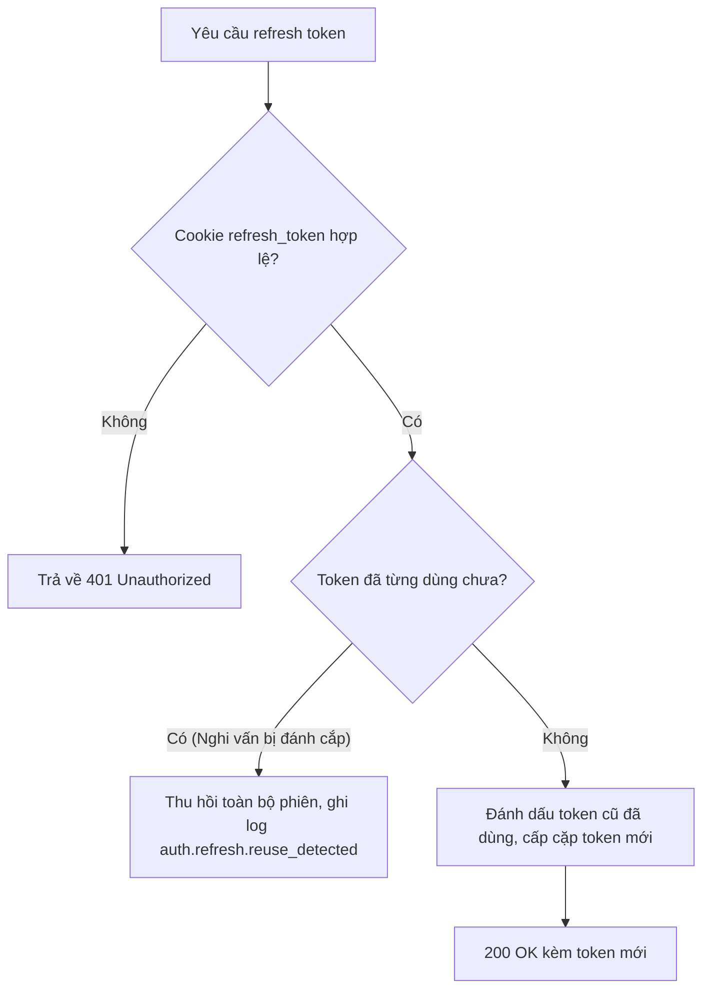

# Quy Trình Nghiệp Vụ Tổng Thể (System Business Flows)

> **Dự án**: [Tên Dự Án]  
> **Phiên bản**: 1.0 - YYYY-MM-DD  
> **Khuôn mẫu**: Rút gọn từ `Mẫu quy trình nghiệp vụ` (Chuẩn Vibe Coding)  
> **Được tạo & duy trì bởi**: Lệnh `/business-flow`  
> **Nguyên tắc**: Không chứa mã code kỹ thuật. Chỉ chứa LUỒNG để người dùng và AI nhìn rõ ứng dụng vận hành ra sao.

---

## Mục lục quy trình (Table of Flows)

| Mã | Tên quy trình | Tác nhân chính | Trạng thái |
|---|---|---|:---:|
| **QT-01** | [Đăng ký, đăng nhập & Thiết lập ban đầu](#qt-01-đăng-ký-đăng-nhập--thiết-lập-ban-đầu) | Khách, Thành viên, Super Admin | Đã duyệt |
| **QT-02** | [Quản lý phiên đăng nhập & Đổi mật khẩu](#qt-02-quản-lý-phiên-đăng-nhập--đổi-mật-khẩu) | Thành viên hệ thống | Đã duyệt |
| **QT-03** | [Quản trị không gian làm việc & Phân quyền](#qt-03-quản-trị-không-gian-làm-việc--phân-quyền) | Workspace Owner, Admin | Đang làm |

---

## QT-01: Đăng ký, đăng nhập & Thiết lập ban đầu

### 1. Tóm tắt
Người dùng mới có thể tự đăng ký tài khoản bằng email/mật khẩu hoặc Google OAuth và vào app ngay lập tức. Lần đầu cài đặt hệ thống, tài khoản đầu tiên được kích hoạt vai trò Super Admin.

### 2. Tác nhân & Quyền hạn
| Tác nhân | Vai trò hệ thống | Được làm gì trong quy trình |
|---|---|---|
| Khách (Guest) | Chưa đăng nhập | Xem trang chủ, điền form đăng ký, gửi form đăng nhập |
| Người dùng (User) | Đã đăng nhập | Nhận token, truy cập không gian làm việc cá nhân |
| Super Admin | Quản trị viên tối cao | Cấu hình cài đặt toàn hệ thống lần đầu |

### 3. Luồng chính - Đăng ký tài khoản
| Bước | Ai | Hành động | Hệ thống xử lý | Kết quả người dùng thấy |
|---|---|---|---|---|
| 1 | Khách | Nhập Họ tên, Email, Mật khẩu -> Bấm "Đăng ký" | Kiểm tra email chưa tồn tại trong cơ sở dữ liệu | Form hiển thị trạng thái loading |
| 2 | Hệ thống | | Băm mật khẩu (Argon2id/Bcrypt), tạo bản ghi User mới | Gán vai trò mặc định `workspace_member` |
| 3 | Hệ thống | | Cấp cặp token: Access Token (15 phút) + Refresh Token (7 ngày trong HttpOnly cookie) | Chuyển hướng người dùng vào màn hình chính |

### 4. Luồng chính - Đăng nhập
| Bước | Ai | Hành động | Hệ thống xử lý | Kết quả người dùng thấy |
|---|---|---|---|---|
| 1 | Khách | Nhập Email + Mật khẩu -> Bấm "Đăng nhập" | Đối chiếu mật khẩu băm | Form loading |
| 2 | Hệ thống | | Kiểm tra tài khoản đang ở trạng thái kích hoạt (`status = active`) | |
| 3 | Hệ thống | | Ghi log kiểm toán `auth.login.success`, cấp cặp token mới | Chuyển hướng vào Workspace |

### 5. Sơ đồ xử lý phiên & làm mới token

### 6. Luồng lỗi & Trường hợp ngoại lệ
| Mã lỗi | Tình huống | Hệ thống xử lý | Thông báo cho người dùng |
|---|---|---|---|
| `E-AUTH-01` | Email đã được đăng ký từ trước | Từ chối tạo tài khoản, trả về mã 409 Conflict | "Email này đã được sử dụng. Vui lòng đăng nhập hoặc dùng email khác." |
| `E-AUTH-02` | Mật khẩu không chính xác | Tăng bộ đếm thử sai (Rate limit), trả về 401 | "Email hoặc mật khẩu không chính xác." |
| `E-AUTH-03` | Tài khoản bị khóa hoặc vô hiệu hóa | Chặn đăng nhập, ghi log audit | "Tài khoản của bạn tạm thời bị khóa. Vui lòng liên hệ Admin." |

### 7. Quy tắc nghiệp vụ (Business Rules)
- **BR-01**: Mật khẩu tối thiểu 8 ký tự, bao gồm ít nhất 1 chữ hoa, 1 chữ thường và 1 chữ số.
- **BR-02**: Quá 5 lần đăng nhập thất bại liên tiếp trong 15 phút sẽ tạm khóa IP trong 15 phút.
- **BR-03**: Mọi thay đổi về mật khẩu phải gửi email thông báo bảo mật tới người dùng.

### 8. Tiêu chí nghiệm thu (Acceptance Criteria)
- **AC-01**: Cho người dùng chưa có tài khoản / Khi nhập đúng thông tin đăng ký hợp lệ / Thì tài khoản được tạo thành công và tự động đăng nhập vào ứng dụng.
- **AC-02**: Cho người dùng nhập sai mật khẩu quá 5 lần / Khi thử lại lần thứ 6 / Thì hệ thống khóa tạm thời và hiển thị thông báo chờ.
