# KIẾN TRÚC TỔNG THỂ ỨNG DỤNG VIỆT HOÁ GAME V2 (`vn.hokvi.viethoa.v2`)

> Nguồn sự thật duy nhất: [`docs/OLD_TOOL_COMPREHENSIVE_AUDIT.md`](file:///c:/Users/ThienDuong/Downloads/Rebuild-APK/docs/OLD_TOOL_COMPREHENSIVE_AUDIT.md)  
> Mục tiêu tài liệu: Định hình cấu trúc package, module, các tầng trừu tượng và luồng dữ liệu cho 4 tầng vá (Mục 2) cùng 8 nhóm tính năng (Mục 4).

---

## 1. SƠ ĐỒ MODULE & PHÂN RÃ PACKAGE

Toàn bộ ứng dụng được tổ chức theo kiến trúc Clean Architecture & Unidirectional Data Flow (UDF), phân tách độc lập giữa Tầng Shell (OS/Kernel), Tầng Động cơ Vá (Patch Engine), Tầng Dịch vụ Ngầm và Tầng Giao diện Jetpack Compose.

```
vn.hokvi.viethoa.v2/
├── MainActivity.kt                      // 1 Activity duy nhất quản lý vòng đời & theme
├── navigation/
│   ├── Screen.kt                        // Danh mục Route & StringRes tiêu đề
│   └── AppNavHost.kt                    // Điều hướng Compose M3
├── core/
│   ├── shell/                           // TẦNG SHELL & QUYỀN HỆ THỐNG
│   │   ├── ShellExecutor.kt             // Interface chạy lệnh shell trừu tượng
│   │   ├── ExecutionResult.kt           // Data class: exitCode, stdout, stderr, durationMs
│   │   ├── RootShell.kt                 // Implementation qua binary "su"
│   │   ├── ShizukuShell.kt              // Implementation qua dev.rikka.shizuku:api
│   │   ├── AdbWirelessShell.kt          // Implementation qua libadb-android + Conscrypt
│   │   ├── ShellResolver.kt             // Bộ định tuyến quyền: Root -> Shizuku -> ADB
│   │   └── ShellLogger.kt               // Ghi nhật ký tập trung vào nhat-ky.txt
│   ├── patch/                           // ĐỘNG CƠ VÁ GAME (4 TẦNG)
│   │   ├── PatchEngine.kt               // Điều phối viên thực thi tuần tự 4 tầng
│   │   ├── PatchSource.kt               // Interface cung cấp tệp bản vá sạch (không dùng HVX cũ)
│   │   ├── LocalAssetPatchSource.kt     // Nạp bản vá đóng gói sẵn trong assets
│   │   ├── ApkPatchProvider.kt          // TẦNG 1: Xử lý APK loading (Stub/Delta)
│   │   ├── QtsVFSManager.kt             // TẦNG 2: Ghi đè CSDL QtsVFSCache (gói 1 & 4)
│   │   ├── WatchdogLockManager.kt       // TẦNG 3: Cắm chốt vi_bak/ & unstickPackage2
│   │   └── DynamicVFSMount.kt           // TẦNG 4: Mount /sdcard/.../HOKVI/
│   ├── detector/                        // NHẬN DIỆN MÔI TRƯỜNG & GAME
│   │   ├── GameStateDetector.kt         // Trạng thái com.tencent.tmgp.osgame, phiên bản, loại APK
│   │   └── SpacePlanner.kt              // Đo đạc bộ nhớ trống (cần 2–4 GB)
│   └── guide/                           // HƯỚNG DẪN THIẾT BỊ ĐỘNG
│       ├── DeviceGuideRepository.kt     // Đọc huong-dan-thiet-bi.json
│       └── DeviceMatcher.kt             // Khớp 9 OEM Profile & 15 Topic theo Build.BRAND
├── service/                             // SERVICES, RECEIVERS & WORKERS
│   ├── adb/
│   │   ├── AdbNsdScanner.kt             // Quét cổng mDNS ADB không dây
│   │   ├── AdbPairService.kt            // Dịch vụ ghép nối mã PIN qua Notification
│   │   ├── AdbKeepService.kt            // Tiền tuyến giữ kết nối socket ADB
│   │   └── AdbReplyReceiver.kt          // Nhận mã PIN từ thanh thông báo
│   ├── installer/
│   │   └── SystemInstallerReceiver.kt   // BroadcastReceiver nhận kết quả PackageInstaller
│   └── worker/
│       └── UpdateCheckWorker.kt         // WorkManager kiểm tra cập nhật (thay UpdateCheckJob)
├── feature/                             // 8 NHÓM TÍNH NĂNG NGHIỆP VỤ
│   ├── music/
│   │   └── MusicManager.kt              // Quản lý 50 bài hát, nạp /HOKVI/music/
│   ├── showtime/
│   │   ├── ShowtimeManager.kt           // Tuỳ biến chữ 1–5 ký tự, nạp /HOKVI/showtime/
│   │   └── ShowtimePreviewRenderer.kt   // Vẽ xem trước Canvas thời gian thực
│   ├── meta/
│   │   └── MetaSyncManager.kt           // Tải & kiểm tra SHA-256 lineup-vi.json, ai-vi.json
│   ├── diag/
│   │   └── DiagnosticsManager.kt        // Tạo bao-cao-chan-doan-*.txt, dump 200 dòng logcat
│   └── updater/
│       └── SelfUpdateManager.kt         // Kiểm tra latest.json, tải & cài APK mới
└── ui/                                  // GIAO DIỆN JETPACK COMPOSE (MATERIAL 3)
    ├── theme/                           // Theme, Bảng màu Dark/Gold/Cyberpunk, Typography
    └── screens/
        ├── DashboardScreen.kt           // Tổng quan trạng thái Shell & Game
        ├── PatchScreen.kt               // Bảng điều khiển cài đặt bản vá & khôi phục gốc
        ├── MusicScreen.kt               // Trình quản lý danh sách nhạc sảnh
        ├── ShowtimeScreen.kt            // Tuỳ biến biểu ngữ Khải Hoàn sân khấu
        ├── GuideScreen.kt               // Cây hướng dẫn theo từng dòng máy (OEM)
        └── LogsScreen.kt                // Trình xem & trích xuất nhat-ky.txt
```

---

## 2. LUỒNG DỮ LIỆU 4 TẦNG VÁ (DATA FLOW - MỤC 2)

Quá trình thi công bản vá được thực hiện tuần tự qua 4 tầng kỹ thuật liên hoàn thông qua duy nhất lớp `ShellExecutor`:

```mermaid
sequenceDiagram
    autonumber
    actor User as Người dùng
    participant UI as PatchScreen
    participant Engine as PatchEngine
    participant Shell as ShellExecutor
    participant Source as PatchSource
    participant Target as Tencent Game Storage

    User->>UI: Bấm "Bắt đầu Việt hoá"
    UI->>Engine: startPatching(options)
    
    rect rgb(30, 40, 60)
        Note over Engine,Target: KIỂM TRA ĐIỀU KIỆN TIÊN QUYẾT
        Engine->>Shell: checkFreeSpace()
        Shell-->>Engine: dungLượngTrống >= 2GB
        Engine->>Shell: checkGameRunning()
        alt Game đang chạy
            Engine->>Shell: am force-stop com.tencent.tmgp.osgame
        end
    end

    rect rgb(40, 60, 40)
        Note over Engine,Target: TẦNG 1: VÁ NHỊ PHÂN / CÀI ĐẶT APK LOADING
        Engine->>Engine: ApkPatchProvider.prepareLoadingApk()
        alt Cần cài font.apk
            Engine->>Shell: pm install -r font.apk (hoặc qua PackageInstaller)
            Shell-->>Engine: Success
        end
    end

    rect rgb(60, 50, 30)
        Note over Engine,Target: TẦNG 2: GHI ĐÈ CƠ SỞ DỮ LIỆU QtsVFSCache
        Engine->>Target: Kiểm tra tệp gốc 1.db, 4.db
        Engine->>Shell: cp 1.db 1.db.orig && cp 4.db 4.db.orig (Sao lưu an toàn)
        Engine->>Source: Lấy file bản vá (1.db, 1_0.db, 4.db, 4_0.db)
        Engine->>Engine: Xác minh SHA-256 & kích thước
        Engine->>Shell: Ghi đè vào /data/data/com.tencent.tmgp.osgame/files/QtsVFSCache/packages/
    end

    rect rgb(50, 30, 50)
        Note over Engine,Target: TẦNG 3: CẮM CHỐT WATCHDOG & DỌN KẸT GÓI 2
        Engine->>Shell: mkdir -p files/vi_bak
        Engine->>Shell: echo "1.8.0.1" > files/vi_bak/txt_1.ver
        Engine->>Shell: echo "1.8.0.1" > files/vi_bak/txt_4.ver
        Engine->>Shell: Kiểm tra phiên bản packages/2 vs packages/0
        alt packages/2 bị kẹt
            Engine->>Shell: mv packages/2 files/vi_bak/pkg2_<timestamp>
        end
    end

    rect rgb(30, 50, 60)
        Note over Engine,Target: TẦNG 4: MOUNT HỆ THỐNG FILE ĐỘNG (/HOKVI/)
        Engine->>Shell: mkdir -p /sdcard/Android/data/com.tencent.tmgp.osgame/files/HOKVI/
        Engine->>Shell: copy font.ttf, manifest.json, lineup-vi.json, ai-vi.json
        Engine->>Shell: đồng bộ thư mục music/ và showtime/
    end

    Engine-->>UI: Báo cáo thành công (PatchCompleted)
    UI-->>User: Hiển thị trạng thái "Đã Việt hoá" & Nút "Mở Game"
```



---

## 3. LUỒNG DỮ LIỆU CHO 8 NHÓM TÍNH NĂNG (MỤC 4)

### 3.1. Nhóm 1: Trình Quản Lý & Thi Công Bản Vá (Core Engine)
- **Đầu vào:** Trạng thái hệ thống (tệp game hiện tại, dung lượng ổ đĩa), cấu hình tuỳ chọn từ người dùng (`wantImages`, `wantRules`, `keepGocPref`).
- **Xử lý:**
  1. `GameStateDetector.detect()` kiểm tra xem game `com.tencent.tmgp.osgame` đã cài đặt chưa, phân tích `versionCode`, xác định loại APK hiện thời (`goc`, `base`, `key`, `font`).
  2. `SpacePlanner.plan()` tính toán dung lượng trống: nếu $< 2\text{ GB}$ hiển thị cảnh báo chặn cài đặt.
  3. `PatchEngine.execute()` chạy tuần tự 4 tầng nêu trên.
  4. Nút "Khôi phục gốc" kích hoạt `PatchEngine.rollback()`: khôi phục ngay lập tức từ `1.db.orig` và `4.db.orig`, xoá cờ hiệu trong `vi_bak/` và gỡ bỏ `/HOKVI/`.
- **Đầu ra:** Trạng thái game được cập nhật, sẵn sàng khởi chạy qua `launchGame()` (`am start`).

### 3.2. Nhóm 2: Quản Lý & Thay Thế Nhạc Nền Game (`MusicScreen`)
- **Đầu vào:** Các tệp `.mp3` hoặc `.wav` người dùng chọn qua `ActivityResultContracts.OpenDocument()`.
- **Xử lý:**
  1. `MusicManager` kiểm tra giới hạn: số lượng tối đa 50 bài, mỗi bài $\le 64\text{ MB}$.
  2. Trích xuất metadata (Title, Artist, Duration), cho phép người dùng đổi tên và sắp xếp vị trí phát ($\uparrow / \downarrow$).
  3. Khi bấm "Nạp vào game": copy các bài hát được bật vào `/sdcard/Android/data/com.tencent.tmgp.osgame/files/HOKVI/music/`.
- **Đầu ra:** VFS động của Unity Engine nạp trực tiếp danh sách nhạc mới lúc vào sảnh.

### 3.3. Nhóm 3: Tuỳ Biến Sân Khấu Xuất Trận (`ShowTimeScreen`)
- **Đầu vào:** Chuỗi ký tự người dùng nhập: Bên trái (1–5 ký tự), Bên phải (1–5 ký tự), tuỳ chọn ảnh khuôn hình.
- **Xử lý:**
  1. `ShowtimePreviewRenderer` sử dụng font `Oswald-Bold-HOKVI.ttf` vẽ văn bản lên Canvas thời gian thực (đầy đủ gradient, viền, bóng đổ và kích thước chuẩn khung xuất trận).
  2. Khi người dùng bấm "Áp dụng": tạo asset hình ảnh / cấu hình tương thích và ghi vào `/sdcard/.../HOKVI/showtime/`.
- **Đầu ra:** Cảnh giới thiệu Kỳ thủ đầu trận hiển thị khẩu hiệu cá nhân hoá.

### 3.4. Nhóm 4: Tự Động Đồng Bộ Đội Hình Meta & AI (`LineupSync` & `AiViSync`)
- **Đầu vào:** URL `https://s3.cloudfly.vn/wxq/lineup-vi_latest.json` và `ai-vi_latest.json`.
- **Xử lý:**
  1. `MetaSyncManager` tải chỉ mục `lineup-vi_latest.json` và `ai-vi_latest.json`.
  2. So sánh `version` hoặc `content_sha256` với tệp stamp hiện có trên máy (`lineup-vi.stamp`, `ai-vi.stamp`).
  3. Nếu có bản mới: tải gói nén `.json.gz`, kiểm tra SHA-256 gói, giải nén và kiểm tra `json_sha256`.
  4. Ghi trực tiếp tệp JSON vào `/HOKVI/lineup-vi.json` và `/HOKVI/ai-vi.json`.
- **Đầu ra:** Giao diện gợi ý tướng và cẩm nang trận đấu trong game được cập nhật theo meta mới nhất mà không cần cài lại bản vá game.

### 3.5. Nhóm 5: Động Cơ ADB Không Dây Độc Lập (In-App ADB)
- **Đầu vào:** Tín hiệu Wi-Fi nội bộ, dịch vụ Gỡ lỗi không dây trên Android 11+ (API 30+).
- **Xử lý:**
  1. `AdbNsdScanner` lắng nghe mDNS trên mạng LAN tìm dịch vụ `_adb-tls-pairing._tcp` và `_adb-tls-connect._tcp` để bắt cổng kết nối ngẫu nhiên.
  2. `AdbPairService` hiển thị thông báo với hành động Direct Reply.
  3. Người dùng nhập mã PIN 6 số trên thanh thông báo $\rightarrow$ `AdbReplyReceiver` nhận chuỗi PIN và gọi `libadb-android` bắt tay chứng chỉ TLS qua Conscrypt.
  4. Sau khi ghép nối thành công, `AdbKeepService` giữ socket tiền tuyến kết nối liên tục với `localhost:<port>`.
- **Đầu ra:** `AdbWirelessShell` sẵn sàng thực thi mọi lệnh shell mà không cần máy tính hoặc Shizuku.

### 3.6. Nhóm 6: Cầu Nối Shizuku & Root Tự Động
- **Đầu vào:** Trạng thái dịch vụ Shizuku và binary `su`.
- **Xử lý:**
  1. `ShellResolver` thăm dò tuần tự:
     - Thử `RootShell`: chạy `su -c id`. Nếu thành công $\rightarrow$ chọn Root.
     - Nếu không có Root, kiểm tra `ShizukuShell`: gọi `Shizuku.pingBinder()`. Nếu Shizuku đang chạy và đã cấp quyền $\rightarrow$ chọn Shizuku. Nếu chưa cấp quyền $\rightarrow$ kích hoạt `Shizuku.requestPermission()`.
     - Nếu Shizuku chưa sẵn sàng $\rightarrow$ chuyển hướng sang `AdbWirelessShell`.
  2. Báo lỗi và gợi ý giải pháp cụ thể nếu không có bất kỳ backend nào khả dụng.
- **Đầu ra:** Kênh thực thi lệnh shell thống nhất cho `PatchEngine`.

### 3.7. Nhóm 7: Chẩn Đoán Hệ Thống & Báo Cáo Lỗi (`Diag` & `Feedback`)
- **Đầu vào:** Luồng thực thi lệnh của `ShellLogger`, thông tin thiết bị từ `Build`, 200 dòng Logcat gần nhất.
- **Xử lý:**
  1. Mọi lệnh qua `ShellExecutor` đều được `ShellLogger` ghi: `[timestamp] command | exit_code | stderr | duration_ms` vào tệp `nhat-ky.txt`.
  2. Khi người dùng bấm "Tạo báo cáo lỗi": `DiagnosticsManager` tổng hợp: Dòng máy, OS, SELinux status, bộ nhớ, package game, backend shell hiện hành, 200 dòng logcat gần nhất vào file `bao-cao-chan-doan-<timestamp>.txt`.
- **Đầu ra:** Tệp báo cáo hoàn chỉnh phục vụ hỗ trợ người dùng hoặc gửi phản hồi.

### 3.8. Nhóm 8: Tự Động Cập Nhật Bản Thân & Thông Báo Cập Nhật Game
- **Đầu vào:** Máy chủ S3 Cloudfly (`latest_url` trong `manifest.json`), lịch kích hoạt WorkManager.
- **Xử lý:**
  1. `UpdateCheckWorker` chạy định kỳ qua WorkManager (khi có mạng, có thể kích hoạt sau khi BOOT_COMPLETED).
  2. Tải `latest.json`: kiểm tra `versionCode` của app và phiên bản game `game_version`.
  3. Nếu có bản cập nhật app: hiển thị thông báo đẩy; khi người dùng đồng ý, tải APK và kích hoạt `PackageInstaller` qua `ApkProvider`.
  4. Nếu có bản cập nhật game: thông báo cho người dùng biết bản vá tương thích đã sẵn sàng.
- **Đầu ra:** Ứng dụng và bản vá luôn được duy trì ở trạng thái mới nhất.
